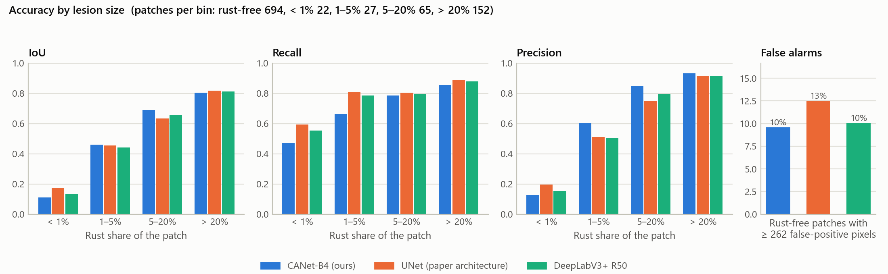
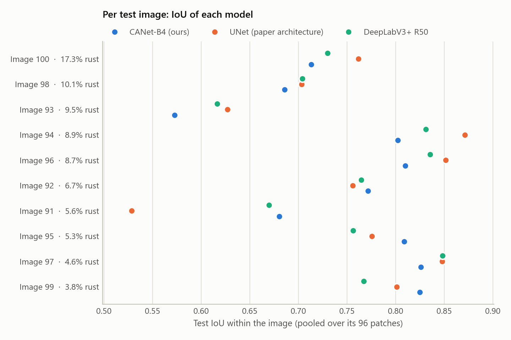
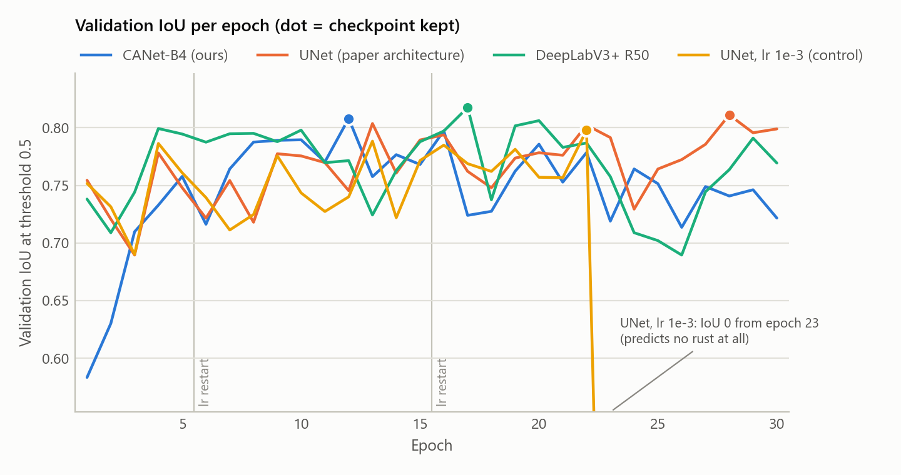
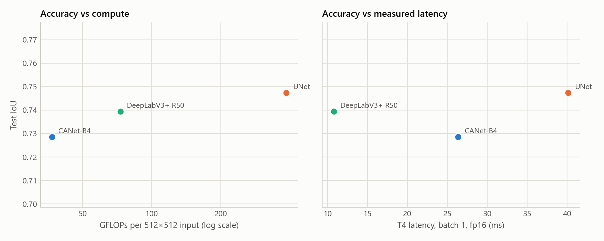

# Results: CANet-B4 against the NWRD paper's UNet and DeepLabV3+ R50

*Final, 2026-10-17.* Three seeds per model at both scales, under the protocol in
[`protocol.md`](protocol.md). Every number here comes from a file in `results/` (Appendix).
CANet-B4 is "ours" throughout; it is reported as measured, including where it loses.

---

## 1. Bottom line

| | 512px (native resolution) | 128px (the NWRD paper's scale) |
|---|---|---|
| Test IoU, CANet-B4 | 0.729 ± 0.013 | 0.704 ± 0.004 |
| Test IoU, UNet (paper architecture, re-trained) | 0.747 ± 0.012 | 0.749 ± 0.009 |
| Test IoU, DeepLabV3+ R50 | 0.739 ± 0.021 | – |
| CANet-B4 − UNet, 95% CI (resampling photographs) | −0.019 [−0.042, +0.019] | −0.045 [−0.081, −0.006] |
| Pre-registered verdict against UNet | **comparable** | **worse** |
| Pre-registered verdict against DeepLabV3+ R50 | **comparable** (−0.011 [−0.024, +0.008]) | – |
| GFLOPs per input, CANet-B4 vs UNet | 36.9 vs 385.3 (10.4× fewer) | 2.3 vs 24.1 (10.4× fewer) |

1. **Accuracy.** CANet-B4 does not segment rust more accurately than the paper's UNet
   architecture. At 512px the difference is within test-set noise (*comparable*), although
   CANet-B4 is lower on all three seeds against both baselines. At the paper's 128px scale it is
   significantly worse (photograph CI below 0; seed-level t-test p = 0.030).
2. **Efficiency.** CANet-B4 needs a tenth of UNet's computation at any input size. At 512px that
   makes it faster on every device measured. At 128px it is faster only when batched and on the
   CPU. It is not faster than DeepLabV3+ R50 on a GPU (§6).
3. **The published baseline.** CANet-B4 far exceeds the paper's published figures (F1 0.826 vs
   0.557 at the paper's scale), but so does the paper's own UNet when re-trained under this
   protocol (F1 0.857). The gain over the published numbers therefore comes from the training and
   evaluation protocol, not from CANet-B4's architecture (§4).

---

## 2. Main experiment: 512px

Test split: 10 photographs, 960 patches, 266 with rust, 8.0% rust pixels. Threshold chosen per run
on validation; metrics pooled over all test pixels; mean ± sample standard deviation over seeds.

| Model | Seeds | IoU | Dice / F1 | Precision | Recall | IoU at 0.5 | IoU, rust patches only |
|---|---|---|---|---|---|---|---|
| **CANet-B4 (ours)** | 3 | 0.729 ± 0.013 | 0.843 ± 0.009 | 0.840 ± 0.012 | 0.846 ± 0.015 | 0.713 ± 0.010 | 0.785 ± 0.013 |
| UNet (paper architecture) | 3 | **0.747** ± 0.012 | **0.855** ± 0.008 | 0.835 ± 0.013 | **0.877** ± 0.002 | **0.721** ± 0.023 | **0.790** ± 0.007 |
| DeepLabV3+ R50 | 3 | 0.739 ± 0.021 | 0.850 ± 0.014 | 0.834 ± 0.043 | 0.869 ± 0.023 | 0.719 ± 0.027 | 0.786 ± 0.013 |
| UNet, lr 1e-3 (control) | 1 | 0.616 | 0.763 | 0.685 | 0.861 | 0.616 | 0.728 |

| CANet-B4 minus | ΔIoU | 95% CI, photographs (p) | 95% CI, patches | ΔDice (95% CI, photographs) | Seed t-test p | CANet-B4 higher | Verdict |
|---|---|---|---|---|---|---|---|
| UNet | −0.019 | [−0.042, +0.019] (0.26) | [−0.042, +0.003] | −0.013 [−0.028, +0.013] | 0.20 | 0 of 3 seeds | comparable |
| DeepLabV3+ R50 | −0.011 | [−0.024, +0.008] (0.21) | [−0.031, +0.007] | −0.007 [−0.017, +0.005] | 0.16 | 0 of 3 seeds | comparable |

- **The UNet baseline.** The shared-lr `unet` beat the `unet_tuned` control on validation in every
  session (0.820 vs 0.798), so `unet` is the paper-architecture baseline. The control also
  collapsed late in training, predicting no rust from epoch 23 of its run.
- **Weighting photographs equally** instead of pooling pixels, the three models tie: mean
  per-photograph IoU 0.750 (CANet-B4), 0.752 (UNet), 0.752 (DeepLabV3+). CANet-B4 is better than
  UNet on 4 of the 10 test photographs, and than DeepLabV3+ on 4.
- **Without threshold tuning** (fixed 0.5), every model loses 0.016–0.026 IoU and the ranking is
  unchanged.

---

## 3. The paper's scale: 128px

Each 512px patch halved (Lanczos) and cut into 2×2 tiles of 128px: the paper's patch size and
field of view. Test split: the same 10 photographs, 3,840 tiles, 722 with rust, 8.1% rust pixels.

| Model | Seeds | IoU | Dice / F1 | Precision | Recall | IoU at 0.5 | IoU, rust tiles only | IoU per seed |
|---|---|---|---|---|---|---|---|---|
| **CANet-B4 (ours)** | 3 | 0.704 ± 0.004 | 0.826 ± 0.003 | 0.817 ± 0.019 | 0.837 ± 0.013 | 0.684 ± 0.008 | 0.778 ± 0.008 | 0.701, 0.702, 0.709 |
| UNet (paper architecture) | 3 | **0.749** ± 0.009 | **0.857** ± 0.006 | **0.850** ± 0.012 | **0.863** ± 0.006 | **0.731** ± 0.010 | **0.798** ± 0.003 | 0.758, 0.752, 0.739 |

CANet-B4 − UNet: ΔIoU −0.045, 95% CI [−0.081, −0.006] resampling test photographs (p 0.028),
[−0.061, −0.030] resampling tiles; seed-level t-test p 0.030; CANet-B4 lower on all 3 seeds and
on 7 of the 10 photographs. **Verdict: worse.**

**Effect of scale.** Going from 512px to 128px costs CANet-B4 0.024 IoU and leaves UNet unchanged
(0.747 → 0.749). At 128px CANet-B4's deepest feature map is 4×4, so two of its three context flows
pool the whole map and its context module can add little ([`protocol.md`](protocol.md) §2.1). The
architecture is being run below the scale it was designed for.

---

## 4. Against the paper's published numbers

These rows are context, not a paired comparison: the paper's test photographs, training (APF,
RMSprop at lr 1e-6, 500 epochs, focal loss) and metric averaging all differ from ours.

| Source | Test set | Precision | Recall | F1 / Dice | IoU |
|---|---|---|---|---|---|
| NWRD paper: UNet + APF (Table 3) | full test set | 0.506 | 0.624 | 0.557 | – |
| CANet-B4, 128px | all test tiles | 0.817 | 0.837 | 0.826 | 0.704 |
| UNet re-trained here, 128px | all test tiles | 0.850 | 0.863 | 0.857 | 0.749 |
| NWRD paper: UNet + APF (Table 4) | background-only patches removed | 0.593 | 0.552 | 0.564 | 0.438 |
| CANet-B4, 128px | rust tiles only | 0.918 | 0.837 | 0.875 | 0.778 |
| UNet re-trained here, 128px | rust tiles only | 0.914 | 0.863 | 0.888 | 0.798 |

Both re-trained models far exceed the published figures at the paper's own scale. Because the
paper's architecture, trained from scratch under our protocol, does as well as or better than
CANet-B4, **the gain over the published numbers is not due to CANet-B4's architecture**. It comes
from differences in training and evaluation that this study cannot separate: optimiser and
learning rate, loss, augmentation, a threshold chosen on validation, pooled rather than
per-image metrics, and a different set of test photographs. The paper's own Table 4 F1 and IoU are
not consistent as pooled values ([`paper_summary.md`](paper_summary.md) §6), which is another
reason not to compare decimals.

---

## 5. Where the models differ (512px)

### 5.1 By lesion size

Test patches binned by their share of rust pixels; scores pooled within each bin, mean over seeds.

| Rust share of the patch | Patches | Share of all rust pixels | IoU: CANet-B4 / UNet / DLv3+ | Recall | Precision |
|---|---|---|---|---|---|
| < 1% | 22 | 0.1% | 0.111 / **0.172** / 0.132 | 0.471 / **0.595** / 0.555 | 0.128 / **0.196** / 0.154 |
| 1–5% | 27 | 1.0% | **0.460** / 0.454 / 0.442 | 0.663 / **0.807** / 0.787 | **0.601** / 0.510 / 0.507 |
| 5–20% | 65 | 9.6% | **0.690** / 0.633 / 0.657 | 0.785 / **0.803** / 0.797 | **0.851** / 0.749 / 0.793 |
| > 20% | 152 | 89.3% | 0.804 / **0.818** / 0.812 | 0.855 / **0.886** / 0.878 | **0.931** / 0.914 / 0.916 |

On rust-free patches (694), CANet-B4 raises a visible false alarm (at least 0.1% of the patch
predicted as rust) on 9.6% of them, against 12.5% for UNet and 10.1% for DeepLabV3+.

CANet-B4 is the most conservative model: the highest precision on every lesioned bin but the
smallest, and the lowest recall in every bin. That makes it the best model on medium lesions
(1–20% of a patch) and the most reluctant to raise false alarms. But patches more than 20% rust
hold 89% of all rust pixels, and there it under-segments, which decides the pooled IoU. Its
1/4-resolution head and single skip connection are a plausible cause, not a tested one. The
figure is `results/analysis/512px/lesion_size.png`:

At 128px UNet matches or beats CANet-B4 in every bin, and false alarms are equal (6.8% vs 7.0%;
`results/analysis/128px/`).

### 5.2 By test photograph

No model wins consistently. Per-photograph IoU ranges from 0.57 to 0.83 for CANet-B4 and from 0.53
to 0.87 for UNet. That spread across photographs is far larger than the gaps between models, which
is why the confidence intervals resample photographs.

### 5.3 Training behaviour and threshold sensitivity

| | CANet-B4 | UNet | DeepLabV3+ R50 |
|---|---|---|---|
| Best epoch (seeds 42, 43, 44) | 12, 9, 23 | 28, 30, 30 | 17, 12, 16 |
| Validation IoU at 0.5: best → final epoch | 0.79–0.83 → 0.72–0.76 | 0.81–0.82 → 0.80–0.82 | 0.81–0.82 → 0.76–0.79 |
| Val-selected threshold (seeds) | 0.76, 0.76, 0.86 | 0.76, 0.68, 0.66 | 0.69, 0.81, 0.60 |
| Training time (min/epoch, T4) | 3.2 | 6.6 | 2.2 |

The pretrained models peak early and then overfit; model selection on validation keeps their best
epoch. UNet, trained from scratch, is still improving at epoch 30. Validation IoU is flat near
every chosen threshold: it changes by at most 0.017 within ±0.10 of it.

---

## 6. Efficiency

Measured on one Tesla T4 (PyTorch 2.10, random weights, median of 100 timed runs) and Kaggle's
2-thread CPU (median of 10); FLOPs count a multiply-add as 2.

### 6.1 At 512px

| Model | Params (M) | GFLOPs | T4 fp32, bs 1 (ms) | T4 fp16, bs 1 (ms) | T4 fp16 throughput, bs 8 (img/s) | Peak memory, bs 8 (MB) | CPU, bs 1 (ms) | Train (min/epoch) |
|---|---|---|---|---|---|---|---|---|
| **CANet-B4** | 29.4 | **36.9** | 30.6 | 26.3 | 72.6 | **744** | 725 | 3.2 |
| UNet | 31.0 | 385.3 | 94.9 | 40.1 | 28.0 | 1,874 | 3,157 | 6.6 |
| DeepLabV3+ R50 | 26.7 | 73.1 | **27.3** | **10.8** | **95.4** | 835 | **579** | **2.2** |

- **Against UNet, CANet-B4 is cheaper on every measure:** 10.4× fewer FLOPs, 3.1× lower fp32
  latency, 2.6× the fp16 throughput, 2.5× less memory, 4.4× faster on the CPU, and training epochs
  half as long.
- **Against DeepLabV3+ R50, fewer FLOPs do not mean faster.** CANet-B4 needs half the FLOPs but is
  2.4× slower in fp16 on the T4, 1.1× slower in fp32 and 1.25× slower on the CPU. A plausible
  reason, not profiled here: EfficientNet's depthwise convolutions and squeeze-and-excitation
  blocks are memory-bound and gain little from tensor cores, which ResNet-50's dense convolutions
  use well.
- **The saving comes from the encoder, not the context module.** A DeepLabV3+ with the same
  EfficientNet-B4 encoder (`deeplabv3plus_b4`, not trained) costs 35.7 GFLOPs, about the same as
  CANet-B4's 36.9 (measured with `nwrd.benchmark.count_flops`).

### 6.2 At 128px

| Model | GFLOPs | T4 fp32, bs 1 (ms) | T4 fp16, bs 1 (ms) | fp16 throughput, bs 8 / bs 64 (img/s) | Peak memory, bs 64 (MB) | CPU, bs 1 (ms) | Train (min/epoch) |
|---|---|---|---|---|---|---|---|
| **CANet-B4** | **2.3** | 23.8 | 25.4 | 299 / **865** | **647** | **72** | 3.1 |
| UNet | 24.1 | **7.3** | **3.7** | **468** / 530 | 1,540 | 162 | **1.7** |

At this size the GPU is dominated by per-layer overhead, not arithmetic. CANet-B4 is about 30
blocks deep, so on single tiles it is 6.8× slower than UNet in fp16, and it trains 1.8× slower per
epoch at batch 8. Only at batch 64 does its lower FLOP count win (1.6× the throughput, 2.4× less
memory). On the CPU it is 2.3× faster.

### 6.3 Per photograph

For one 4608×3456 photograph (61 native 512px patches, or 243 tiles of 128px at 0.5×, by area):

| Scale | Model | TFLOPs | T4 fp16, batched (s) | CPU, bs 1 (s) |
|---|---|---|---|---|
| 512px | CANet-B4 | 2.24 | 0.84 | 44.0 |
| 512px | UNet | 23.41 | 2.17 | 191.8 |
| 128px | CANet-B4 | 0.56 | 0.28 | 17.4 |
| 128px | UNet | 5.85 | 0.46 | 39.5 |

---

## 7. How large is run-to-run noise?

The first Kaggle session of the main experiment ran the same protocol, data and seeds before it
was cut off (`results/512px/replicate/`); the final runs were trained from scratch in later
sessions. Test IoU for identical seeds:

| Run | Session 1 | Final | Difference |
|---|---|---|---|
| CANet-B4, seed 42 | 0.726 | 0.718 | 0.008 |
| CANet-B4, seed 43 | 0.716 | 0.744 | **0.028** |
| UNet, seed 42 | 0.731 | 0.737 | 0.005 |
| DeepLabV3+ R50, seed 42 | 0.729 | 0.719 | 0.010 |
| UNet lr 1e-3, seed 42 | 0.658 | 0.617 | 0.042 |

A seed does not pin a result down: GPU nondeterminism and, in these runs, unseeded augmentation
(`results/README.md`) move test IoU by up to 0.028 for CANet-B4. That is larger than its 0.019 gap
to UNet at 512px. Differences between single runs below about 0.03 IoU therefore carry no
information, and the verdicts rest on three seeds and the photograph bootstrap.

---

## 8. What can be claimed

Supported by these results:

- *"Trained and evaluated under an identical protocol with three seeds, CANet-B4 reaches test IoU
  0.729 ± 0.013 on 512px patches, comparable to the NWRD paper's UNet architecture (0.747 ± 0.012;
  ΔIoU −0.019, 95% CI [−0.042, +0.019] resampling test photographs) and to DeepLabV3+ R50
  (0.739 ± 0.021)."*
- *"At the paper's own 128px scale, CANet-B4 is less accurate than the paper's UNet architecture
  (0.704 ± 0.004 vs 0.749 ± 0.009; ΔIoU −0.045, 95% CI [−0.081, −0.006])."*
- *"CANet-B4 needs 10.4× fewer FLOPs than the paper's UNet at any input size. At 512px it runs 3.1×
  faster on a T4 GPU (fp32, batch 1) and 4.4× faster on a CPU, with 2.5× less GPU memory."*
- *"Both CANet-B4 and the paper's re-trained UNet exceed the paper's published scores by a wide
  margin, so that improvement comes from the training and evaluation protocol rather than from
  CANet-B4's architecture."*

Not supported, and not claimed:

- That CANet-B4 is more accurate than either baseline.
- That CANet-B4 is faster than DeepLabV3+ R50, or that its context module is what makes it cheap.
- That CANet-B4 beats the paper's full method (UNet + APF): APF was not reproduced.
- Anything finer than 10 test photographs can resolve.

---

## 9. Limitations

1. **Ten test photographs, five for validation.** They bound the precision of every estimate.
2. **One shared schedule.** The pretrained models peak between epochs 9 and 23 and then overfit,
   while the from-scratch UNet is still improving at epoch 30. A longer schedule would more likely
   help UNet than CANet-B4.
3. **Pretraining is folded into "architecture",** and the same-encoder ablation that would
   separate encoder from context module was not trained.
4. **APF and the paper's own test set are not reproduced.**
5. **Compression robustness is untested.** The training patches are lossless PNG. In a smoke test
   of the app on one rust-heavy 1024×1024 region of test photograph 100, re-encoding it as JPEG at
   quality 95 (a mean change of 0.8 grey levels) lowered the share predicted as rust from 61% to
   49%. One region is anecdotal, but field photographs are usually JPEG, so this needs a test-set
   evaluation before deployment.
6. **Efficiency was measured on one GPU type (T4) and one CPU type.**

---

## Appendix: where every number comes from

| Numbers | Source |
|---|---|
| §1–3 accuracy, significance and verdicts | `results/512px/final/comparison.json` and `results/128px/final/comparison.json` (`summary`, `significance`) |
| Per-photograph, lesion size, false alarms, training, thresholds | `results/analysis/512px/analysis.json`, `results/analysis/128px/analysis.json` (`scripts/analyse_results.py`) |
| Effect of scale, per-photograph cost | `results/analysis/scales.md` (`scripts/compare_scales.py`) |
| Efficiency | `results/512px/final/benchmark.json`, `results/128px/final/benchmark.json`; training time from each run's `history.json` |
| Run-to-run noise | `results/512px/replicate/log.txt` against `results/512px/final/` (`analysis.json`, `replicate`) |
| Paper figures | Anwar et al. 2023, Tables 3 and 4 ([`paper_summary.md`](paper_summary.md)) |
| DeepLabV3+ B4 FLOPs | `nwrd.benchmark.count_flops(build_model('deeplabv3plus_b4', pretrained=False), 512, cpu)`, run 2026-10-17 |
| JPEG observation | App smoke test, 2026-10-17 (not part of the results folders) |
